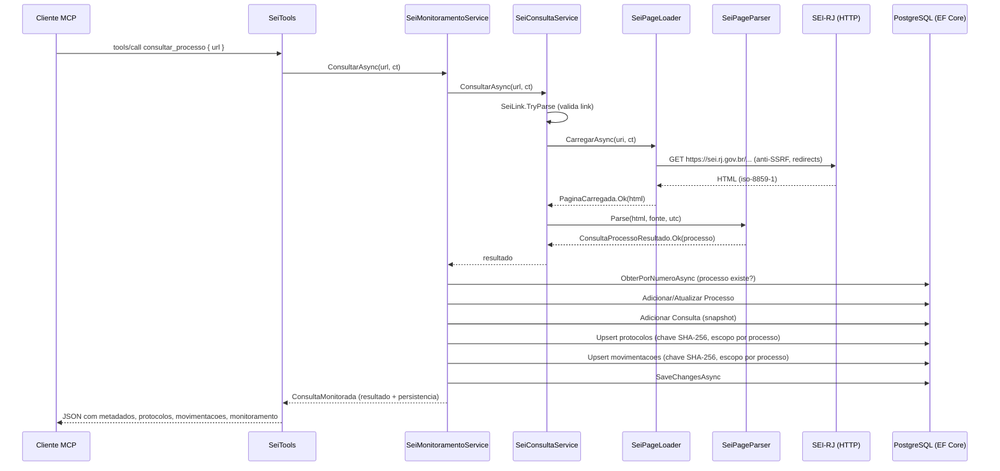
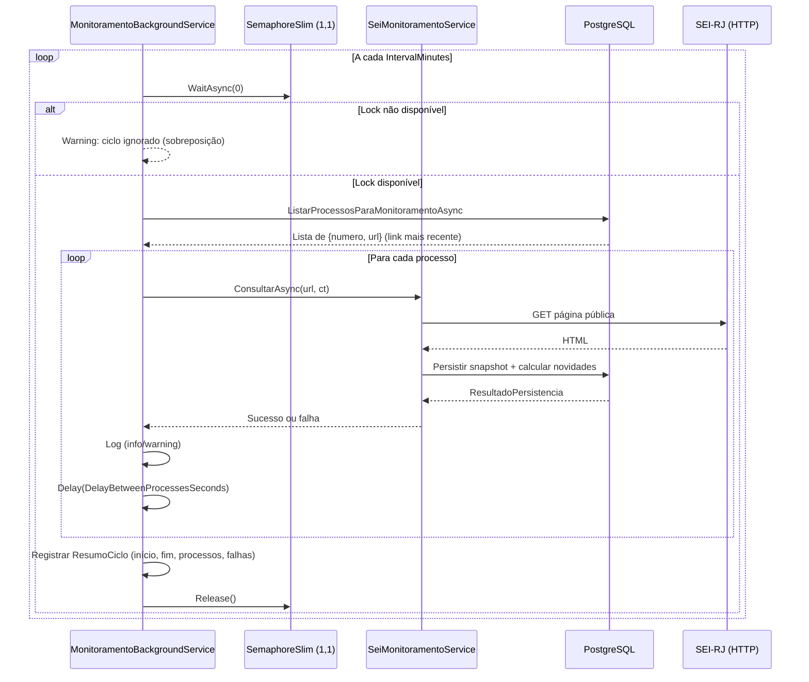

# Fluxo de Execução — SEI-RJ Monitor MCP

Este documento descreve, passo a passo, os fluxos principais do sistema com base na implementação real (`src/`).

## 1. Inicialização da aplicação

O ponto de entrada é `src/Presentation/Program.cs`. Ao iniciar (`dotnet run` ou container):

1. Cria o `WebApplicationBuilder` com Kestrel configurado:
   - `AddServerHeader = false` (oculta header do servidor).
   - `MaxRequestBodySize` configurável (padrão 1 MB).
   - `RequestHeadersTimeout` de 15 s.
   - `KeepAliveTimeout` de 2 minutos.
2. Chama `builder.Services.AddSeiRjMonitor(builder.Configuration)` (CrossCutting), que:
   - Lê a connection string de `ConnectionStrings:SeiMonitor` ou monta por variáveis isoladas (`SEI_DB_*`, `PG*`, `PGPASSFILE`).
   - Configura `SeiRjMonitorDbContext` com Npgsql, retry transitório (3×, 5 s) e timeout de comando (5–120 s).
   - Registra `MonitoramentoOptions` e `SeiHttpOptions` a partir da seção `SeiMonitor`.
   - Registra `ISeiPageLoader` e `ISeiPageParser` como singleton.
   - Registra repositórios e `IUnitOfWork` como scoped.
   - Registra `SeiConsultaService` e `SeiMonitoramentoService` como scoped.
3. Registra `MonitoramentoBackgroundService` como hosted service (singleton).
4. Registra `SeiTools` como singleton.
5. Configura health checks: `PostgresHealthCheck` com tag `"ready"`.
6. Configura o servidor MCP (`AddMcpServer().WithHttpTransport().WithToolsFromAssembly()`).
7. Configura CORS se `Seguranca:AllowedOrigins` estiver preenchido.
8. Chama `ValidarConfiguracaoDeSeguranca`:
   - Em `Production`, exige `Seguranca:ApiKey` (senão lança exceção e impede o start).
   - A chave deve ter pelo menos 32 caracteres; o valor `change_me` é recusado.
   - Em `Development`, sem chave, a autenticação fica desativada com aviso no log.
9. Constrói a aplicação e adiciona middlewares:
   - `UseExceptionHandler` com resposta `application/problem+json` genérica (não-Development).
   - `UseHsts` (não-Development).
   - Middleware de headers de segurança (`X-Content-Type-Options`, `X-Frame-Options`, `Referrer-Policy`, `Permissions-Policy`, `CSP`, `Cache-Control`, `HSTS`).
   - CORS (se configurado).
   - `ApiKeyAuthenticationMiddleware` (protege `/mcp`).
   - Aviso se `AllowedHosts` está aberto em Production.
10. Mapeia endpoints:
    - `GET /` — status e resumo do último ciclo do monitoramento.
    - `GET /health/live` — liveness sem dependências.
    - `GET /health/ready` — readiness (PostgreSQL).
    - `MAP /mcp` — endpoint MCP Streamable HTTP.
11. Loga inicialização (ambiente, endpoints, se autenticação está ativa).
12. Chama `app.Run()`.

## 2. Entrada de uma requisição MCP

O cliente MCP se conecta via **Streamable HTTP** em `https://SEU_HOST/mcp`.

Fluxo da requisição:

1. A requisição HTTP chega ao Kestrel.
2. Passa pelos middlewares de headers de segurança.
3. Se `AllowedOrigins` estiver configurado, CORS é aplicado.
4. O `ApiKeyAuthenticationMiddleware` intercepta requisições cujo caminho inicia com `/mcp`:
   - Se não houver chave configurada (`_chaveEsperadaHash is null`), libera (apenas Development).
   - Se for `OPTIONS`, libera (preflight CORS).
   - Extrai a chave de `Authorization: Bearer <chave>` ou `X-Api-Key: <chave>`.
   - Calcula SHA-256 da chave recebida e compara com `CryptographicOperations.FixedTimeEquals` contra o hash armazenado.
   - Se inválida/ausente, retorna **401 Unauthorized** com `WWW-Authenticate: Bearer` e corpo JSON `{ erro: "Não autorizado." }`; registra apenas o IP de origem no log.
5. Se autenticado (ou não exigido), a requisição segue para o endpoint `/mcp` do servidor MCP.
6. O `ModelContextProtocol.Server` processa a mensagem JSON-RPC (`initialize`, `tools/list`, `tools/call`, notificações, etc.).
7. As respostas podem ser enviadas como SSE (`text/event-stream`) ou JSON simples, conforme o cabeçalho `Accept` do cliente.

## 3. Autenticação, validação e seleção da ferramenta

Não há autenticação de usuário final além da chave de API do endpoint MCP. Não há escopos, papéis ou autorização granular.

Ao receber `tools/call`:

1. O servidor MCP identifica o nome da ferramenta entre as 4 registradas com `[McpServerTool]`:
   - `consultar_processo`
   - `historico_processo`
   - `listar_processos_monitorados`
   - `validar_link_processo`
2. Vincula os parâmetros fornecidos no `arguments` da chamada JSON-RPC aos parâmetros do método C# (descritos com `[Description]`).
3. `SeiTools` executa a operação dentro de `ComTratamentoAsync`, que:
   - Cria um escopo de DI próprio (`IServiceScopeFactory.CreateAsyncScope`) para isolar o `DbContext` por chamada (as ferramentas são singletons).
   - Chama `SeiMonitoramentoService`.
   - Captura exceções de infraestrutura (`DbException`, `DbUpdateException`, `TimeoutException`) e retorna JSON estável `{ erro: "...", tipoFalha: "FalhaInfraestrutura" }` sem vazar detalhes.
   - Propaga `OperationCanceledException` se o cancelamento for solicitado.

## 4. Fluxo de consulta do processo (`consultar_processo`)

1. `SeiTools.ConsultarProcesso(url, cancellationToken)` recebe a URL completa.
2. Chama `SeiMonitoramentoService.ConsultarAsync(url, cancellationToken)`.
3. `SeiMonitoramentoService` chama `SeiConsultaService.ConsultarAsync(url, cancellationToken)`.
4. `SeiConsultaService`:
   - Valida o link com `SeiLink.TryParse(url, out var link, out var erro)`. Se inválido, retorna `LinkInvalido`.
   - Chama `_loader.CarregarAsync(link.Uri, cancellationToken)` (`SeiPageLoader`).
5. `SeiPageLoader.CarregarAsync`:
   - Revalida o link com `SeiLink.TryParse` (defesa em profundidade).
   - Faz requisição HTTP GET com `HttpCompletionOption.ResponseHeadersRead`.
   - Se houver redirecionamento (3xx), revalida cada `Location` com `SeiLink.TryParse`; segue se válido, bloqueia caso contrário. Limite configurável (padrão 5).
   - Se não for sucesso (não 2xx), retorna `FalhaHttp` com o status HTTP.
   - Verifica `Content-Length` e, durante a leitura do stream, o limite de bytes (padrão 5 MB).
   - Lê o corpo decodificando explicitamente pelo charset (SEI-RJ usa `iso-8859-1`).
6. `SeiConsultaService` recebe o HTML e chama `_parser.Parse(html, fonte, consultadoEmUtc)`.
7. `SeiPageParser.Parse`:
   - Verifica se o corpo contém "Processo não encontrado" → `ProcessoNaoEncontrado`.
   - Verifica se há CAPTCHA ("Digite o código da imagem") e sem tabelas → `RequerInteracaoHumana`.
   - Extrai `#tblCabecalho` (metadados), `#tblDocumentos` (protocolos), `#tblHistorico` (movimentações).
   - Se não encontrar nenhuma das tabelas, retorna `LayoutDesconhecido`.
   - Extrai número do processo (cabeçalho ou regex no corpo), tipo, data de geração, interessados, restrição de acesso.
   - Extrai protocolos (leitura posicional, 6 células por linha) e movimentações (leitura posicional, 3 células por linha).
   - Classifica cada movimentação com `ClassificadorEvento.Classificar(descricao)`.
   - Retorna `ConsultaProcessoResultado.Ok(processoConsultado)`.

## 5. Acesso ao SEI-RJ

O acesso ao SEI-RJ é feito exclusivamente por `SeiPageLoader` via HTTP GET, com as seguintes características confirmadas:

- Esquema obrigatório: `https`.
- Host permitido: `sei.rj.gov.br` ou subdomínios (`*.sei.rj.gov.br`).
- Porta: 443.
- Caminho exato: `/sei/modulos/pesquisa/md_pesq_processo_exibir.php`.
- Sem userinfo (usuário:senha) na URL.
- `AllowAutoRedirect = false`; redirecionamentos são seguidos manualmente com revalidação.
- `UseProxy = false` (proxy automático desabilitado).
- User-Agent personalizado identificando o SEI-RJ-Monitor.
- `Accept: text/html,application/xhtml+xml` e `Accept-Language: pt-BR,pt;q=0.9`.
- `AutomaticDecompression = All`.
- `ConnectCallback` personalizado que resolve DNS e valida que **todos** os endereços são públicos antes de conectar (anti-DNS rebinding).
- Timeout total configurável (padrão 30 s, faixa 5–120 s).
- Timeout de conexão configurável (padrão 10 s, faixa 3–60 s).
- Limite de resposta configurável (padrão 5 MB, faixa 64 KB–20 MB).

Não há acesso a documentos restritos, não há resolução de CAPTCHA, não há autenticação no SEI.

## 6. Parser e transformação dos dados

O parser `SeiPageParser` (AngleSharp) extrai:

### Cabeçalho (`#tblCabecalho`)
- Processo (número)
- Tipo
- Data de Geração (também aceita "Data de Geracao")
- Interessados
- Acesso restrito (detectado por ícone `img[title*='Acesso Restrito']` ou `img[src*='chave_restrito']`, ou texto no corpo)

### Protocolos (`#tblDocumentos`)
Leitura posicional das células:
- [0] checkbox (ignorada)
- [1] número do protocolo (validado por regex `EhNumeroProtocolo`)
- [2] tipo
- [3] data
- [4] inclusão
- [5] unidade
- [6] ações (ignorada)
- Restrição detectada por ícone na linha.

Natureza: "Processo" se o número começa com "SEI-", senão "Documento".

### Movimentações (`#tblHistorico`)
Leitura posicional:
- [0] data/hora (parse com `dd/MM/yyyy HH:mm`, `dd/MM/yyyy HH:mm:ss`, `dd/MM/yyyy` em pt-BR)
- [1] unidade (link `a.ancoraSigla` ou texto)
- [2] descrição (pode conter unidade relacionada em link `a.ancoraSigla`)

Movimentações são ordenadas por data/hora crescente.

### Contagens declaradas
Extraídas do `<caption>` das tabelas via regex `(\d+)\s+registros?`.

## 7. Persistência e comparação

`SeiMonitoramentoService.ConsultarAsync` executa:

1. Verifica se o processo já existe pelo número (`_processos.ObterPorNumeroAsync`).
   - Se não existir: `primeiraConsulta = true`, cria novo `Processo`.
   - Se existir: carrega o agregado existente.
2. Atualiza dados do processo (tipo, data de geração, interessados, acesso restrito, unidade atual, última consulta).
3. Adiciona ou atualiza o processo no repositório.
4. Cria uma entidade `Consulta` (snapshot) e adiciona ao processo.
5. Adiciona a consulta ao repositório de consultas.
6. Para cada protocolo extraído:
   - Calcula chave SHA-256 de campos normalizados (numero, natureza, tipo, data, inclusão, unidade, acesso restrito).
   - Verifica se já existe no processo (memória) e no banco (`ExisteChaveAsync(processo.Id, chave)`), **escopado por processo**.
   - Se não existir e não for primeira consulta: conta como protocolo novo.
   - Se já existir: atualiza `UltimaDeteccaoUtc`.
7. Para cada movimentação extraída:
   - Calcula chave SHA-256 de campos normalizados (data/hora, unidade, unidade relacionada, tipo evento, descrição).
   - Verifica se já existe no processo (memória) e no banco, **escopado por processo**.
   - Se não existir e não for primeira consulta: adiciona à lista de novas movimentações.
8. Chama `_unitOfWork.SaveChangesAsync(cancellationToken)` (EF Core `SaveChangesAsync`).
9. Retorna `ConsultaMonitorada` com `Resultado` e `ResultadoPersistencia` (processoId, consultaId, primeiraConsulta, contagens de novos/totais, lista de novas movimentações).

### Deduplicação
- Protocolos: índice único `ux_protocolos_processo_chave` em `(processo_id, chave)`.
- Movimentações: índice único `ux_movimentacoes_processo_chave` em `(processo_id, chave)`.
- A deduplicação é **escopada por processo**: a mesma chave pode existir em processos diferentes sem conflito.

### Primeira consulta (linha de base)
Na primeira consulta de um processo, nenhuma movimentação ou protocolo é marcado como "novo". Todos são armazenados como base.

## 8. Detecção de movimentações/protocolos novos

- Um item é considerado "novo" se sua chave SHA-256 não existia previamente para aquele processo **e** não é a primeira consulta.
- Na primeira consulta, todos os itens são armazenados, mas `ProtocolosNovos = 0` e `MovimentacoesNovas = 0` (linha de base).
- O resultado inclui `NovasMovimentacoes` (lista de objetos `Domain.Movimentacao`) para que o serviço de monitoramento possa logar os detalhes.
- O resposta MCP inclui o bloco `monitoramento` com `primeiraConsulta`, `protocolosNovos`, `movimentacoesNovas`, `protocolosTotal`, `movimentacoesTotal`, `novasMovimentacoes` e um `aviso` textual.

## 9. Resposta ao cliente MCP

`SeiTools.MontarSaida` monta o objeto de resposta serializado em JSON (camelCase, indentado):

```json
{
  "fonte": "https://sei.rj.gov.br/...",
  "consultadoEmUtc": "2024-01-20T12:00:00Z",
  "processo": "SEI-260005/005504/2024",
  "tipo": "Processo",
  "dataGeracao": "01/01/2024",
  "interessados": "TESTE DA SILVA",
  "acessoRestrito": false,
  "avisoAcesso": null,
  "protocolosDeclarados": 1,
  "quantidadeProtocolos": 2,
  "protocolosComRestricao": 0,
  "protocolos": [ ... ],
  "andamentosDeclarados": 3,
  "quantidadeMovimentacoes": 3,
  "unidadeAtual": "UNIDADE/TESTE",
  "ultimaMovimentacaoEm": "10/01/2024 10:00",
  "movimentacoes": [ ... ],
  "monitoramento": {
    "processoId": 1,
    "consultaId": 1,
    "primeiraConsulta": false,
    "protocolosNovos": 0,
    "protocolosTotal": 2,
    "movimentacoesNovas": 1,
    "movimentacoesTotal": 3,
    "novasMovimentacoes": [ ... ],
    "aviso": "1 movimentação(ões) nova(s) desde a última consulta registrada."
  },
  "observacao": "Somente informações efetivamente exibidas na consulta pública foram extraídas..."
}
```

Em caso de falha, `SerializarFalha` retorna JSON com `erro`, `tipoFalha` e, quando aplicável, `processoNaoEncontrado`, `requerInteracaoHumana` e `statusHttp`.

## 10. Fluxos de histórico e validação de link

### `historico_processo(numero)`
1. `SeiTools.HistoricoProcesso(numero)` chama `SeiMonitoramentoService.ObterHistoricoAsync(numero)`.
2. Carrega o processo por número com consultas e movimentações.
3. Se não encontrado, retorna `{ encontrado: false }`.
4. Se encontrado, retorna `{ encontrado: true, numero, tipo, dataGeracao, interessados, acessoRestrito, primeiraConsultaUtc, ultimaConsultaUtc, totalConsultas, consultas: [...], movimentacoes: [...] }`.
5. Não faz nova consulta ao SEI-RJ (apenas leitura local).

### `validar_link_processo(url)`
1. `SeiTools.ValidarLinkProcesso(url)` chama `SeiLink.TryParse(url, out var link, out var erro)`.
2. Se inválido: retorna `{ valido: false, erro }`.
3. Se válido: retorna `{ valido: true, host, caminho, possuiParametroDeConsulta, formatoParametro, observacao }`.
4. Não acessa o SEI-RJ (validação estrutural apenas).

### `listar_processos_monitorados`
1. `SeiTools.ListarProcessosMonitorados()` chama `SeiMonitoramentoService.ListarProcessosAsync()`.
2. Chama `_processos.ListarResumosAsync()` que projeta contagens diretamente no banco (`Consultas.Count`, `Movimentacoes.Count`), ordenado por `UltimaConsultaUtc DESC, Id DESC`.
3. Retorna `{ quantidade, processos: [...] }`.

## 11. Tratamento de erros e cancelamento

### Erros de rede/SEI
- `SeiPageLoader` captura `OperationCanceledException` (timeout), `HttpRequestException`, `IOException`, `RespostaMuitoGrandeException`.
- Retorna `PaginaCarregada.Erro` com mensagem genérica; detalhes (host, IP, porta, stack) ficam apenas no log do servidor.
- `SeiConsultaService` propaga o tipo de falha (`FalhaHttp`, `PaginaVazia`, etc.).
- `SeiTools` converte falhas de infraestrutura de banco em `FalhaInfraestrutura` genérica ao cliente.

### Erros de parser/layout
- `ProcessoNaoEncontrado`: link pode ter expirado.
- `RequerInteracaoHumana`: CAPTCHA ou dados indisponíveis.
- `LayoutDesconhecido`: HTML mudou; tratado como falha isolada.

### Cancelamento
- `CancellationToken` é propagado de `Program.cs` → `MonitoramentoBackgroundService` → `SeiMonitoramentoService` → `SeiConsultaService` → `SeiPageLoader` → `HttpClient` e EF Core.
- `HttpClient.Timeout` e `CancellationTokenSource.CreateLinkedTokenSource` cobrem timeout total incluindo leitura do corpo.
- No ciclo de monitoramento, `cts.CancelAfter(TempoLimiteCiclo)` cancela todo o ciclo se exceder o limite.
- Operações individuais respeitam `cancellationToken.IsCancellationRequested`.

### Isolamento de falhas no monitoramento
- Erro em um processo é logado (`Warning`) e o ciclo continua para os próximos.
- Erro no ciclo inteiro é logado (`Error`) e o host continua.
- `SemaphoreSlim(1,1)` impede sobreposição: se um ciclo ainda estiver rodando, o próximo é ignorado com `Warning`.
- `ScopeFactoryQuebrado` (banco indisponível) não derruba o serviço; a exceção é capturada.

## Diagramas de sequência

### Consulta manual (`consultar_processo`)



### Ciclo do BackgroundService



## Relação com outros documentos

- [Arquitetura](02-arquitetura.md) — camadas e componentes.
- [Banco de dados](04-banco-de-dados.md) — tabelas, índices e deduplicação.
- [MCP e integração](05-mcp-e-integracao.md) — contratos das ferramentas.
- [Monitoramento automático](06-monitoramento-automatico.md) — ciclo periódico em detalhe.
- [Segurança](07-seguranca.md) — SSRF, autenticação, limites.